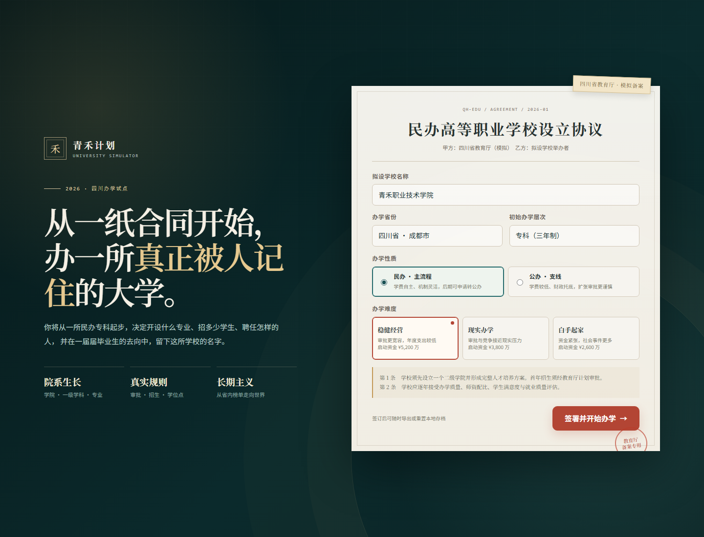

# 青禾计划 · 高校模拟器

一个从民办专科起步的中文网页模拟经营游戏原型。无需安装第三方依赖，直接由浏览器运行。

## 在线玩

- GitHub Pages：[wangshangruicn.github.io/qinghe-university-simulator](https://wangshangruicn.github.io/qinghe-university-simulator/)
- GitHub CDN（国内网络更稳定）：[打开手机版](https://cdn.jsdelivr.net/gh/wangshangruiCN/qinghe-university-simulator@main/index.html)
- CDN 备用节点：[testingcf.jsdelivr.net](https://testingcf.jsdelivr.net/gh/wangshangruiCN/qinghe-university-simulator@main/index.html)

在线版本支持手机浏览器，可通过浏览器菜单“添加到主屏幕”作为网页应用打开。



## 启动

Windows 下可以直接双击 `启动游戏.cmd`，它会启动本地服务并打开浏览器。

也可以在项目目录执行：

```powershell
node server.js
```

然后打开 `http://localhost:4173`。也可以通过 `npm start` 启动。

## 已实现内容

- 教育局合同式开局：学校名称、办学性质、三档难度
- 学院 → 一级学科 → 专业建设，开局六种学院与常见高职专业目录
- 招生计划上报、教育局审批、投放策略和实际报到机制
- 年度财务、学生 cohort、自然流失、毕业与校友数据
- 校务、校长任命、师资引进、办学升格与民办转公办
- 校级、省级、国家级、国际级赛事，社团、校企合作与校友返校日
- 校园地图、用地购买、楼宇建设和属性加成
- 科研项目、科研平台、硕士点与博士点申请
- 四川省榜、全国前 100 与全球榜，非官方模拟数据
- 自动生成新闻的游戏官网，可编辑头条和发布公告
- 本地自动存档、JSON 存档导出、新手教程和移动端布局

## 开发说明

核心文件：

- `index.html`：页面入口
- `styles.css`：视觉系统与响应式布局
- `data.js`：学院、专业、榜单、赛事、建筑等静态内容
- `app.js`：状态、交互、招生与年度结算逻辑
- `server.js`：零依赖的本地静态服务器

榜单使用真实高校名称增强参照感，但大学分数、位次和评价均是虚构的游戏数据，不代表任何官方榜单。
